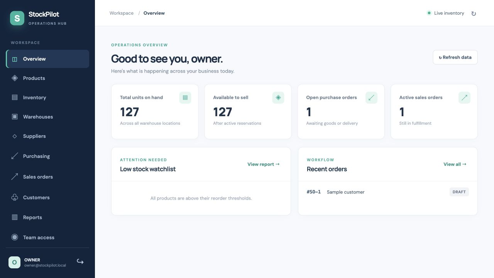
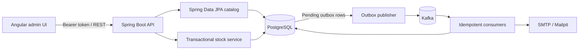

# StockPilot

StockPilot is a small business inventory, purchasing, and order fulfillment system. The Angular admin app reads live Spring Boot APIs; PostgreSQL holds the catalog, orders, reservations, balances, and append-only movement ledger. Kafka receives events through a transactional outbox.

## Run locally

1. Copy `.env.example` to `.env` and replace both passwords. The seed password must have at least 12 characters.
2. Run `docker compose up --build -d`.
3. Open [StockPilot](http://localhost:4200). Sign in as `owner@stockpilot.local` using `SEED_ADMIN_PASSWORD`.
4. API docs: [OpenAPI UI](http://localhost:8080/docs); mail preview: [Mailpit](http://localhost:8025); health: [Actuator](http://localhost:8080/actuator/health).

The seed creates a supplier, customer, two products, a warehouse location, opening stock with ledger entries, a submitted purchase order, and a draft sales order. Seed data is only inserted when the user table is empty. Set `SEED_DATA=false` on a production deployment and provision the first owner account through an operational migration or controlled bootstrap.

For local development, start PostgreSQL, Kafka, and Mailpit with `docker compose up -d postgres kafka mailpit`, run `mvn spring-boot:run` in `backend` with `SEED_ADMIN_PASSWORD`, `DATABASE_URL=jdbc:postgresql://localhost:55432/stockpilot`, and `KAFKA_BOOTSTRAP_SERVERS=localhost:29092`, then run `npm ci && npm start` in `frontend`.

## Architecture

Catalog creation uses Spring Data JPA. The order and stock commands use parameterized SQL through Spring JDBC so row locks, ledger writes, balance updates, and outbox inserts are explicit within one PostgreSQL transaction. Flyway owns the schema; Hibernate validates its mapped entities.

## Stock invariants

- `on_hand >= 0`, `reserved >= 0`, and `reserved <= on_hand` are database checks. Available stock is always `on_hand - reserved`.
- Every physical change to `on_hand` writes exactly one immutable `stock_movements` row in the same transaction. Transfers write one negative and one positive entry. Reservation changes do not alter the physical ledger.
- Balance rows are locked with `SELECT … FOR UPDATE` before stock or reservation changes. A new balance is inserted with `ON CONFLICT DO NOTHING` before it is locked. Transfers acquire location locks in ascending ID order.
- Each stock command has a unique idempotency key in `stock_commands`; receipt references are unique per purchase order. A retry cannot apply stock twice.
- Sales line prices come from the server catalog. Submission reserves stock before it is sold; shipment consumes an active reservation. Expired reservations are released by a scheduled job and the order moves to `STOCK_REQUIRED`.
- `/api/stock/reconciliation` compares each physical balance against the sum of its movement ledger. A nonempty response indicates an integrity problem.
- Purchase receipts cannot exceed ordered quantities. Sales returns cannot exceed fulfilled quantities. Cancellations release active reservations; received purchase orders cannot be cancelled.
- Reports calculate valuation from current variant purchase cost multiplied by on-hand units. This is a **standard-cost estimate**; it is not FIFO or weighted average historical costing.

## Workflows

1. Create products and variants. Each variant has a unique SKU and optional unique barcode.
2. Create a warehouse and locations; receive a submitted purchase order or make a reasoned adjustment to add stock.
3. Create a sales order, reserve every line at a location, mark picking, mark packed, then ship one or more lines. Each shipment can fulfill a subset of lines.
4. Return fulfilled units into a chosen location with a reason. Cancellation is available before any shipment.
5. Review low stock, inventory valuation, stock movements, top selling products, purchasing, processing time, utilization, and pending delivery reports. Each report exports as CSV or PDF.

## Security and operations

Authentication uses 256-bit opaque bearer tokens stored only as SHA-256 hashes in PostgreSQL; passwords use BCrypt. Sessions expire after 12 hours. Five failed login attempts lock the email for 15 minutes. Role checks run on the server. Revoking a user also revokes all sessions. Password reset emails a one-use, 30-minute token and revokes sessions after reset. Run behind HTTPS in production and configure a real SMTP provider. Do not expose PostgreSQL, Kafka, Actuator metrics, or Mailpit publicly. Restrict access to the `/docs` endpoint in production if API metadata is sensitive.

The REST API is documented at `/v3/api-docs`. Sensitive changes require authorized roles. Database constraints validate nonnegative monetary amounts and physical balances. CSV imports have a 2 MB limit, use a proper quoted CSV parser, and reject spreadsheet formula prefixes. CSV exports prefix formula-like cell values with an apostrophe. `audit_events` records authentication, user, order, and stock actions; `stock_movements` records physical inventory changes. Low stock, failed stock updates, and overdue purchase deliveries create outbox events and owner emails.

## Tests and CI

`cd backend && mvn verify` runs JUnit integration tests against a Testcontainers PostgreSQL instance, covering duplicate SKU, receipt retries, stock transfer idempotency, final-unit concurrency, cancellation, partial fulfillment, reconciliation, authentication throttling, and authorization. `cd frontend && npm ci && npm run build` checks the Angular app. GitHub Actions runs both jobs on push and pull request. Docker must be available for backend integration tests. On this macOS setup, export `DOCKER_HOST=unix://$HOME/.docker/run/docker.sock`; if Ryuk cannot be pulled locally, set `TESTCONTAINERS_RYUK_DISABLED=true` for the test run.

## Deployment guide

See [DEPLOYMENT.md](DEPLOYMENT.md) for configuration, migration, backup, and release steps.
